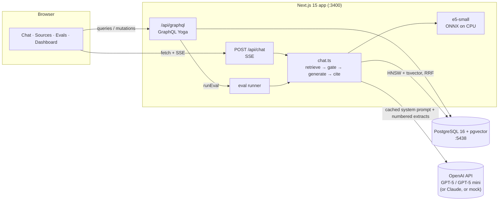
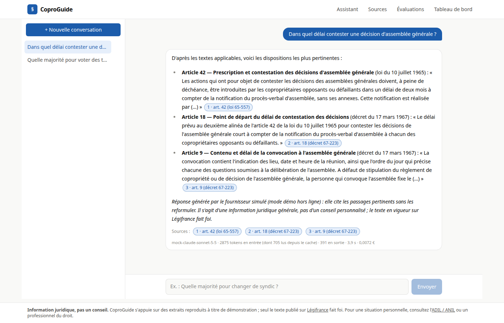
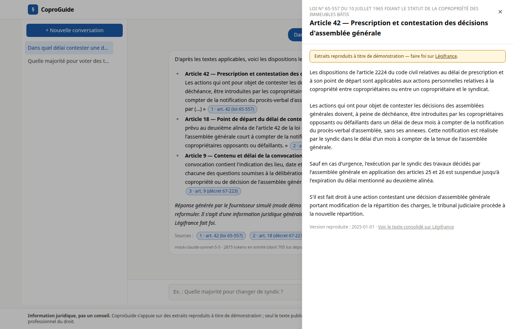
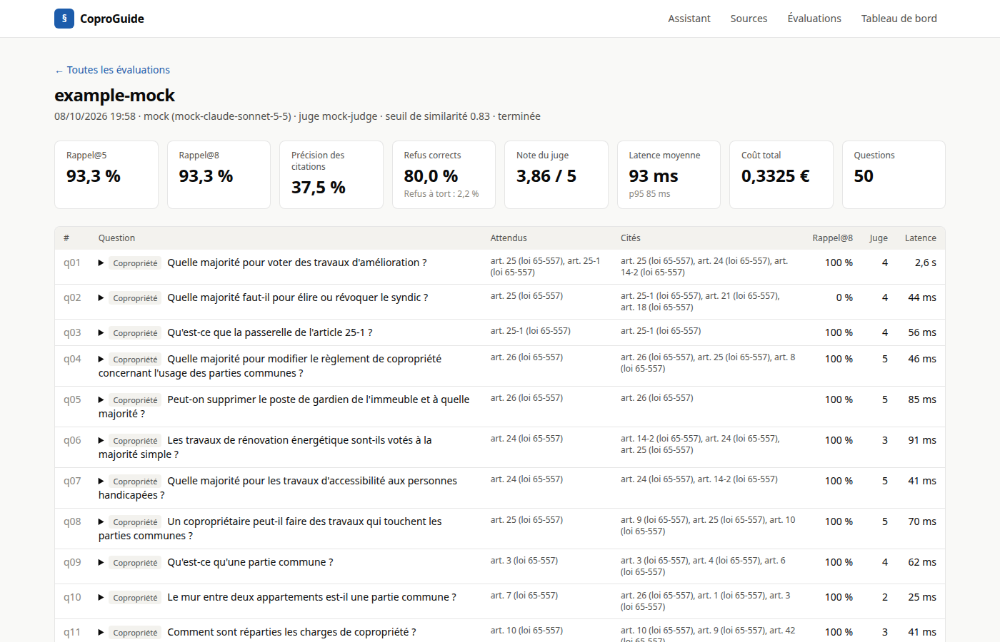
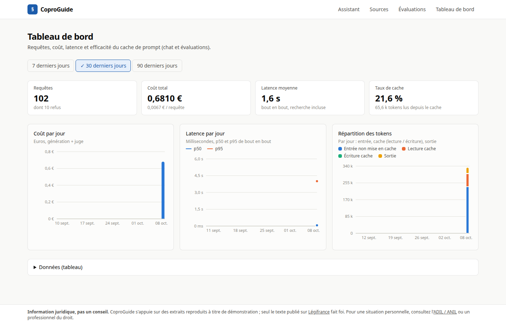

# CoproGuide

**A RAG assistant for French copropriété and residential-lease law: cited articles, streamed answers, a confidence gate that refuses instead of guessing, and a 50-question evaluation harness with a cost and latency dashboard.**

[](https://github.com/slimanitz/coproguide/actions/workflows/ci.yml)
[](LICENSE)


> ⚠️ **Extraits reproduits à titre de démonstration — faire foi sur [Légifrance](https://www.legifrance.gouv.fr).**
> The legal texts in `corpus/` were typed in manually for this demo and can differ from the consolidated versions in force. CoproGuide gives legal *information*, not legal advice.

## Why this project

France has about 10 million homes held in copropriété, most of them run by volunteer conseils syndicaux, and several million private-sector tenants and landlords. The rules they ask about every week (which majority applies, how long a notice period is, when a deposit must be returned) sit in a few dense texts: the loi du 10 juillet 1965, its décret of 1967 and the loi du 6 juillet 1989 as amended by ALUR. CoproGuide shows how to build a trustworthy assistant on top of them. Every claim cites an article, weak retrieval leads to a refusal, and quality, cost and latency are measured rather than assumed.

## Features

- [x] Chat in French with **streamed answers** (Server-Sent Events) and **citation chips** that open the full article in a side panel
- [x] **Hybrid retrieval**: pgvector HNSW (cosine) ∪ PostgreSQL French full-text (`ts_rank_cd`), fused with **Reciprocal Rank Fusion** (k = 60)
- [x] **Local embeddings** with multilingual-e5-small (ONNX, CPU): no key is needed for retrieval
- [x] **Two-stage confidence gate**: a calibrated similarity threshold, plus a `[HORS_CORPUS]` sentinel from the model, give a styled refusal that points to Légifrance / ANIL
- [x] **OpenAI provider** (default real provider): GPT-5 for generation over the Chat Completions API, streaming, low reasoning effort, a byte-stable system prompt placed first so OpenAI's automatic prompt caching can reuse it, and content-filter refusals mapped to the out-of-corpus path. Works with any OpenAI-compatible endpoint (`OPENAI_BASE_URL`)
- [x] **Claude provider** (alternative): Sonnet 5.5 with a **cached system prompt** (`cache_control: ephemeral`), streaming, low effort, and server-side refusal fallback
- [x] **Mock provider**: deterministic, offline, the default in Docker Compose, so the demo works without an API key
- [x] **Cost ledger**: input / output / cache-read / cache-write tokens, latency and cost in € stored for every answer
- [x] **GraphQL API** (Yoga, GraphiQL in dev): conversations, documents, search, eval runs, metrics, `runEval` mutation
- [x] **Evaluation harness**: 50 golden questions (5 out of corpus), recall@5/@8, citation precision, refusal accuracy, LLM-as-judge (GPT-5 mini, or Haiku 5.5 with the Claude provider), latency and cost, with JSON + Markdown reports; API-triggered runs are guarded (one at a time, hourly limit, admin token with the paid provider)
- [x] **Dashboard**: requests, total cost, average latency, cache hit rate; cost per day, p50/p95 latency per day and token split (Recharts), plus a table view
- [x] **Sources page**: the 60 articles, searchable and filterable by text, under the demo banner
- [x] Idempotent ingestion (content hash), Légifrance PISTE refresh script, light and dark themes, CI

## Architecture



A question goes through the following steps:

1. It is embedded locally (`query: ` prefix).
2. Two candidate lists are retrieved inside PostgreSQL: top-20 by vector and top-20 by full-text.
3. The lists are fused with RRF into 8 numbered extracts.
4. If the best cosine similarity is below `RAG_MIN_SIMILARITY` (0.83, calibrated on the golden set), the app refuses without calling the LLM. Otherwise the model answers from the extracts only, citing `[n]`, or replies `[HORS_CORPUS]`.
5. Citations are resolved to articles, and usage and cost are stored.

Key decisions are recorded as ADRs:
[0001 local e5 embeddings](docs/adr/0001-local-e5-embeddings.md) ·
[0002 hybrid retrieval with RRF](docs/adr/0002-hybrid-rrf-retrieval.md) ·
[0003 SSE for chat, GraphQL for the rest](docs/adr/0003-sse-chat-graphql-rest.md).
More diagrams (C4, sequence, data model) are in [docs/architecture.md](docs/architecture.md).

## Quick start

### With Docker Compose (recommended, no key needed)

```bash
docker compose up -d --build      # first build: a few minutes, downloads the e5 model (~130 MB); image ≈ 1.8 GB
open http://localhost:3400        # or xdg-open
```

The web container applies migrations and ingests the corpus on start (this is idempotent). Try *« Quelle majorité pour voter des travaux d'amélioration ? »*: the mock provider answers by quoting article 25 of the loi du 10 juillet 1965.
No login is required. The demo has no user accounts.

Compose loads `.env.example` as defaults and an optional `.env` on top of it, so every variable documented in [.env.example](.env.example) also works in Docker. To use a real model instead of the mock:

```bash
cp .env.example .env               # then set LLM_PROVIDER=openai, OPENAI_API_KEY=sk-...
                                   # (or LLM_PROVIDER=anthropic, ANTHROPIC_API_KEY=sk-ant-...)
                                   # and ADMIN_TOKEN=<random> if you want to start evals from the UI/API
docker compose up -d --build
```

Stop with `make down` (`docker compose down`, keeps the database volume) or wipe everything with `make wipe` (`docker compose down -v`).

### Local development

```bash
pnpm install
docker compose up -d db           # PostgreSQL + pgvector on localhost:5438
pnpm ingest --prune               # migrate + chunk + embed + upsert (idempotent)
pnpm dev                          # http://localhost:3400
```

Requirements: Node 22, pnpm 12, Docker. `make up | down | wipe | dev | seed | test | lint | eval` wrap the same commands. The embedding model is cached in `.cache/models/` (git- and docker-ignored).

## API and usage

| Interface | Endpoint / command | Description |
|---|---|---|
| SSE | `POST /api/chat` `{question, conversationId?}` | Streams `meta`, `text`…, `refused` (refusal, replaces any partial text), `citations`, `usage`, `done` (or `error`); closing the connection aborts the upstream LLM call |
| GraphQL | `POST /api/graphql` | `conversations(limit,offset)`, `conversation(id)` (`messages(limit,offset)`), `documents(law)`, `document(id)`, `search(query,k)`, `evalRuns(limit,offset)`, `evalRun(id)`, `metrics(from,to)`; mutations `createConversation`, `deleteConversation`, `runEval(name)`. Page size 1-100 |
| Health | `GET /api/health` | DB connectivity, provider, number of chunks |
| CLI | `pnpm ingest [--dir corpus] [--prune]` | Parse, chunk, embed and upsert the corpus; skips unchanged articles (text, metadata and embedding/chunk settings are hashed); `--prune` deletes articles no longer in the directory |
| CLI | `pnpm eval [--provider mock\|openai\|anthropic] [--limit n] [--name x]` | Run the golden set; writes `eval_runs`/`eval_results` and `evals/reports/<ts>.{json,md}` |
| CLI | `pnpm calibrate [--holdout]` | Sweep the similarity threshold over the golden set; `--holdout` calibrates on one half and reports on the other |
| CLI | `pnpm fetch:legifrance [--dry-run]` | Refresh the corpus from the Légifrance API (needs `PISTE_CLIENT_ID/SECRET`) |

```bash
curl -N -X POST localhost:3400/api/chat -H 'content-type: application/json' \
  -d '{"question":"Dans quel délai contester une décision d’assemblée générale ?"}'

curl -s localhost:3400/api/graphql -H 'content-type: application/json' \
  -d '{"query":"{ search(query: \"dépôt de garantie meublé\", k: 3) { similarity document { id title } } }"}'
```

### Securing `runEval`

Evaluation runs can be started from the CLI (`pnpm eval`, not limited) or through the API (`runEval` mutation, "Lancer une évaluation" button). API-triggered runs are guarded:

- **One at a time**: a second request gets a `CONFLICT` error while a run is in progress (a run still "running" after 2 h is treated as crashed).
- **Rate limit**: at most `EVAL_RATE_LIMIT_PER_HOUR` (default 3) starts per hour per server process gives `RATE_LIMITED`.
- **Admin token for paid runs**: with a paid provider (`LLM_PROVIDER=openai` or `anthropic`), the caller must send `x-admin-token: $ADMIN_TOKEN`. If `ADMIN_TOKEN` is not set, paid runs cannot be started through the API at all. With the mock provider (no cost) no token is needed.

```bash
curl -s localhost:3400/api/graphql -H 'content-type: application/json' -H "x-admin-token: $ADMIN_TOKEN" \
  -d '{"query":"mutation { runEval(name: \"nightly\") }"}'
```

### Evaluation results (mock provider, committed example)

Report: [evals/reports/example-mock.md](evals/reports/example-mock.md). Retrieval metrics do not depend on the LLM. Answer metrics measure the mock, which quotes passages verbatim, so they are a pipeline smoke test and not a quality claim. No real-key run is committed yet because no `OPENAI_API_KEY` (or `ANTHROPIC_API_KEY`) was available at build time.

> **Caveat: the refusal metrics are optimistic.** The confidence threshold (`RAG_MIN_SIMILARITY = 0.83`) was calibrated on this same golden set, so refusal accuracy and false-refusal rate are measured on the data used to choose the threshold. `pnpm calibrate --holdout` gives an out-of-sample check. It calibrates on half of the questions (stratified, deterministic split) and reports on the other half. On 2026-10-08 the selection rule (refuse the most hors-corpus questions while keeping 100 % of in-corpus ones) picked **0.840** on the calibration half. On the holdout half that threshold kept **22/22** in-corpus questions and refused **2/2** hors-corpus ones. Two hors-corpus questions are far too few to be conclusive. Collecting more out-of-corpus questions is the first item for a trustworthy estimate. The shipped default is 0.83 rather than 0.84, which keeps a margin of 0.013 below the lowest in-corpus similarity (0.843) instead of 0.003.

| Metric | Mock run |
|---|---|
| Recall@5 / recall@8 (45 in-corpus questions) | 93.3 % / 93.3 % |
| Refusal accuracy (5 out-of-corpus) | 80 % (4/5; *bail commercial* is close in embedding space and needs the real model's `[HORS_CORPUS]`) |
| False refusals (in-corpus) | 2.2 % (1/45) |
| Mean latency (retrieval + mock generation) | < 100 ms |

## Testing

```bash
docker compose up -d db   # integration tests need PostgreSQL on :5438 (they are skipped, with a warning, if it is down)
pnpm test                 # unit + integration (Vitest)
pnpm test:unit            # unit only, no database
pnpm lint && pnpm typecheck
pnpm eval                 # 50-question golden set with the mock provider
```

- **Unit** (74 tests): chunker (paragraph alignment, overlap, oversized paragraphs), RRF, cost table and cache-hit rate, confidence gate, streaming sentinel filter (sentinel at the start, mid-answer, split across chunks, or appended after a safety refusal) and the immediate `refused` event, eval-start guard (admin token, single flight, rate limit), ingest fingerprint, threshold calibration and holdout split, SSE encoder/parser (arbitrary chunk boundaries, CRLF), citation parsing, eval metrics, corpus and golden-set integrity, mock provider and judge, the OpenAI provider request shape (system prompt first, reasoning effort only for reasoning models, usage split into uncached input and cache reads, content-filter refusals) and judge (JSON output, refusal recorded as "not judged"), the Anthropic provider request shape (cached system prompt, effort, fallbacks, usage mapping) and the Haiku 5.5 judge against fake clients, and GraphQL resolvers executed through Yoga with a mocked repository (pagination bounds, guard errors mapped to typed GraphQL errors).
- **Integration** (7 tests, real pgvector in a dedicated `coproguide_test` database): ingest a 5-article fixture idempotently, check that hybrid search ranks the expected article first for three questions, run a chat with the mock provider (streamed events, art. 25 cited, message, usage and citations persisted, metrics query), check an out-of-corpus refusal without an LLM call, and check that a conversation delete cascades.
- **CI** (`.github/workflows/ci.yml`) uses a pgvector service container and runs `pnpm lint`, `pnpm typecheck`, `pnpm test`, an ingest plus 10-question eval smoke run, `pnpm build`, and a Docker image build.

## Project structure

```
src/app/                 Next.js pages (chat, sources, evals, dashboard) and API routes (chat SSE, graphql, health)
src/components/          React UI: chat, article panel, sources browser, dashboard charts, stat tiles
src/graphql/             SDL schema, resolvers, Yoga factory
src/lib/                 domain: retrieval + RRF, gate, chunking, embeddings, cost, prompts, SSE, chat, repo
src/lib/llm/             provider interface with OpenAI, Anthropic (Claude) and mock implementations + judges
src/lib/evals/           golden-set loader, metrics, runner and report writer
src/lib/db/              Drizzle schema, client, migrator
corpus/                  60 articles as Markdown with frontmatter (one file per article)
drizzle/                 SQL migrations (tables, HNSW and GIN indexes)
scripts/                 ingest, eval, calibrate, fetch-legifrance, migrate, warm-model
evals/                   golden.jsonl (50 questions) and reports/ (committed mock example)
tests/                   Vitest unit and integration suites, 5-article fixture corpus
docs/                    plan, architecture, user stories, roadmap, ADRs, screenshots
```

### Screenshots

| Chat with citation chips | Article side panel |
|---|---|
|  |  |
| **Evaluation run** | **Dashboard (light / dark)** |
|  |  |

More in [docs/screenshots/](docs/screenshots/) (sources page, dark dashboard).

## Roadmap

See [docs/roadmap.md](docs/roadmap.md). Planned next: a committed real-key eval run, a cross-encoder re-ranker with an ablation study, article-level Légifrance deep links, and rate limiting for a public deployment.

## 🇫🇷 Résumé en français

CoproGuide est un assistant d'information juridique qui répond aux questions sur la copropriété (loi du 10 juillet 1965, décret du 17 mars 1967) et sur les baux d'habitation (loi du 6 juillet 1989, dispositions ALUR sur les meublés).
Chaque réponse est diffusée en streaming et cite les articles utilisés, consultables en un clic.
La recherche est hybride : vecteurs pgvector et plein texte PostgreSQL en français, fusionnés par RRF, avec des embeddings e5 calculés localement.
Une double barrière de confiance (seuil de similarité calibré, puis marqueur `[HORS_CORPUS]` renvoyé par le modèle) fait refuser l'assistant plutôt qu'inventer, avec un renvoi vers Légifrance et l'ADIL.
La génération utilise GPT-5 via l'API OpenAI (ou Claude Sonnet 5.5 en alternative, prompt système mis en cache). Un fournisseur simulé permet une démo hors ligne sans clé.
Un banc d'évaluation de 50 questions mesure le rappel, la précision des citations, les refus, une note donnée par un juge LLM (GPT-5 mini), la latence et le coût en euros. Un tableau de bord suit ces indicateurs.
Stack : Next.js 15, TypeScript, Tailwind, PostgreSQL 16 + pgvector, Drizzle, GraphQL Yoga, Recharts, Vitest, Docker Compose.
Il s'agit d'une information juridique et non d'un conseil ; seul le texte publié sur Légifrance fait foi.

## License

[MIT](LICENSE) © 2026 Slimane Berrada
