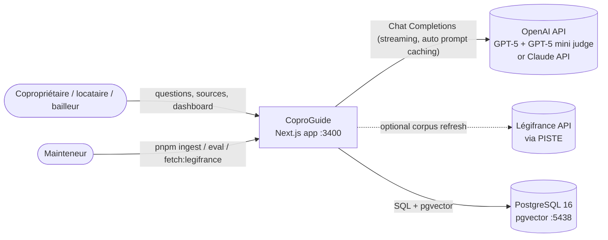

# Architecture

CoproGuide is a single Next.js 15 application (UI + API) backed by PostgreSQL 16 with
pgvector. Embeddings run in-process on CPU; generation and judging call the OpenAI API (GPT-5 family; the Claude API is an alternative), or a
deterministic mock provider for offline use.

## Context (C4 level 1)



## Containers and components (C4 levels 2-3)

```mermaid
flowchart TB
  subgraph browser[Browser]
    chatui[Chat page<br/>streaming markdown, citation chips]
    pages[Sources / Evals / Dashboard]
  end

  subgraph next[Next.js app]
    sse["POST /api/chat<br/>(SSE route)"]
    gql["/api/graphql<br/>(GraphQL Yoga)"]
    rsc[Server components<br/>sources, evals, dashboard]
    subgraph lib[src/lib]
      chat[chat.ts<br/>orchestration + persistence]
      retrieval[retrieval.ts<br/>hybrid search + RRF]
      gate[gate.ts + sentinel-filter.ts<br/>confidence gate]
      llm[llm/<br/>openai | anthropic | mock]
      emb[embeddings.ts<br/>e5-small ONNX]
      repo[repo.ts<br/>Repository]
      evals[evals/<br/>runner + metrics]
      cost[cost.ts]
    end
  end

  scripts[scripts/<br/>ingest, eval, calibrate, fetch-legifrance]
  db[(PostgreSQL + pgvector)]
  claude[(OpenAI / Claude API)]

  chatui -- fetch + SSE --> sse
  chatui -- queries/mutations --> gql
  pages --> rsc
  sse --> chat
  gql --> repo
  gql -- runEval --> evals
  rsc --> repo
  chat --> retrieval --> emb
  chat --> gate
  chat --> llm --> claude
  chat --> cost
  evals --> chat
  retrieval --> db
  repo --> db
  scripts --> lib
```

## Question flow

```mermaid
sequenceDiagram
  participant U as Browser
  participant R as /api/chat
  participant E as e5 embedder
  participant P as PostgreSQL
  participant L as LLM provider
  U->>R: POST {question, conversationId}
  R->>P: create conversation / store user message / load history
  R->>E: embed "query: …"
  R->>P: vector top-20 (HNSW) + full-text top-20 (ts_rank_cd)
  R->>R: RRF fusion → 8 extracts, best cosine similarity
  alt best similarity < RAG_MIN_SIMILARITY
    R-->>U: refused · citations[] · usage(0) · done(refused)
  else
    R-->>U: meta
    R->>L: system prompt (cache_control) + history + numbered extracts
    L-->>R: text deltas
    R-->>U: text… (sentinel stripped; "refused" sent as soon as "[HORS_CORPUS]" appears)
    R->>R: resolve [n] → articles, cost from usage
    R-->>U: citations · usage · done
    R->>P: store assistant message, usage, cost, citations
  end
```

## Data model

| Table | Purpose |
|---|---|
| `documents` | one row per article (`id` = `65-557:25`), metadata, full text, content hash |
| `chunks` | article chunks with `embedding vector(384)` (HNSW, cosine) and a generated French `tsvector` (GIN) |
| `conversations` | chat threads |
| `messages` | user and assistant turns; assistant rows carry tokens (input, output, cache read, cache write), latency, cost €, model, refusal flag, origin (`chat` / `eval`) — this is also the dashboard ledger |
| `citations` | `[n]` markers of an answer resolved to articles/chunks |
| `eval_runs`, `eval_results` | golden-set runs, aggregated metrics (JSONB) and per-question outcomes |

## Key design decisions

- **Local embeddings** (ADR 0001): no key, offline demo, French-capable model; chunk budget
  bounded by e5's 512-token window.
- **Hybrid retrieval with RRF** (ADR 0002): lexical precision on article numbers and legal
  terms, semantic recall on paraphrases, no score normalisation.
- **SSE for chat, GraphQL for the rest** (ADR 0003).
- **Two-stage confidence gate**: a retrieval threshold refuses before spending tokens; the
  model's `[HORS_CORPUS]` sentinel catches questions that are close in embedding space but not
  answered by the extracts (e.g. commercial leases).
- **Prompt caching**: the system prompt is byte-stable (no dates or ids) and sent with
  `cache_control: ephemeral`; extracts and question come after the breakpoint. The dashboard
  shows the cache hit rate measured from `usage.cache_read_input_tokens`.
- **Provider interface** (`LlmProvider`): `openai` for production (`anthropic` as an alternative), `mock` for tests, CI and
  the offline demo. The mock reports estimated token usage priced as the configured model so
  that dashboards and cost reports are meaningful without a key.
